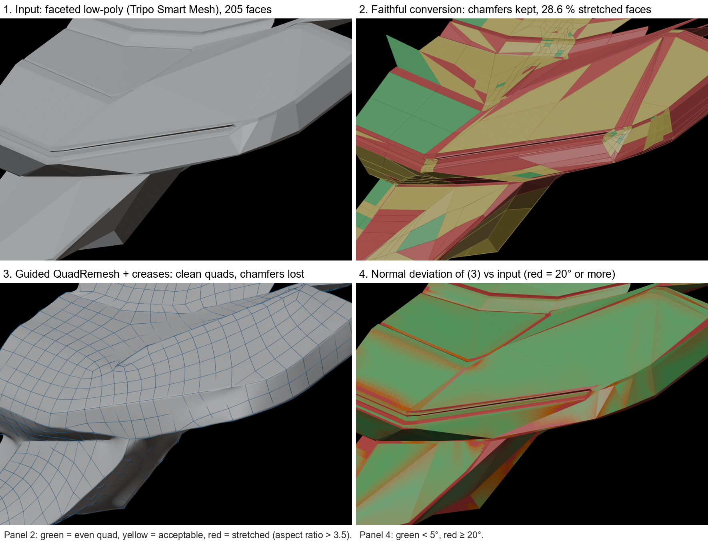
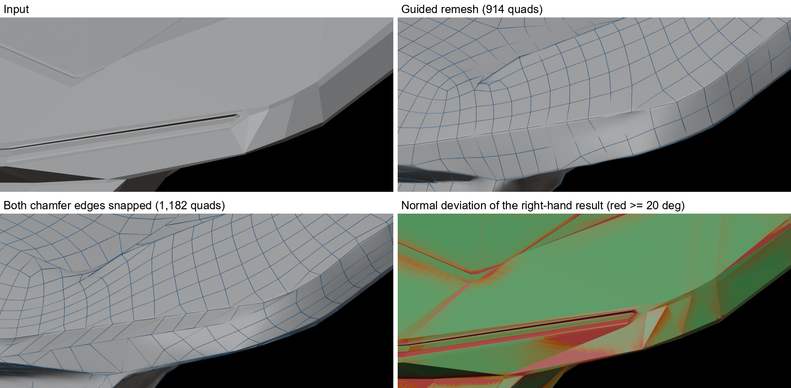
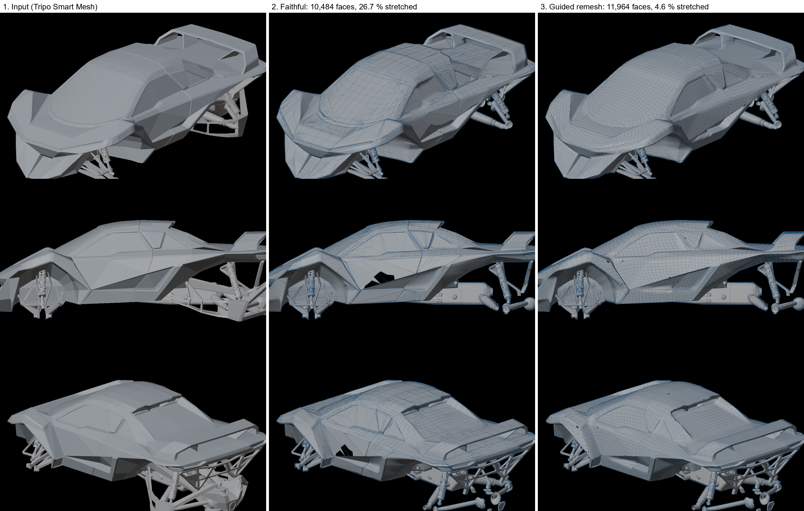

# Malla3D: faceted low-poly → editable SubD cage

Malla3D is an automatic pipeline that takes the low-poly mesh of an image-to-3D generator (here, Tripo's Smart Mesh) and turns it into a **lightweight, editable SubD cage**: all quads, even face sizes, no long sliver faces, with the design's fold lines as crease loops.

It is a work in progress, shared openly. On the test car, the quads already come out clean. **Keeping the small chamfers (1–2 mm) is still an open problem**, so ideas, pull requests and discussion are welcome; see [Open problems](#open-problems-help-wanted).



## Where it stands

Front zone of the test car body (Tripo Smart Mesh, ~500 mm long), all measured on the subdivided surface:

| Version | Quads | Stretched faces (aspect > 3.5) | Surface normal off by > 10° from the input (area) |
|---|---|---|---|
| Input converted faithfully, every fold creased | 1,126 | 28.6 % | 17.2 % |
| **This pipeline, 6 mm grid** | **914** | **0.3–0.7 %** | 20.0 % |
| This pipeline, adaptive grid + both chamfer edges snapped | 1,182 | 6.5 % | 13.5 % |
| Floor: the input itself used as the cage | 205 | — | 4.7 % |

- **Clean quads:** solved. The cage is light, even and editable.
- **Shape:**
  - Large panels: within ~0.2 mm of the input on average.
  - Narrow chamfers, steps and slots (1–2 mm): they melt into soft edges (image below, and panels 3–4 above). A plain distance average hides this, so the normal-deviation map (`mapa_normales.py`) is the measure that matters.



The whole body, with the same recipe:



## How it works, step by step

Every step is a script. Code comments are in Spanish; file names and commands below are what you run. Paths are relative to the repository root.

### 0. Input
A low-poly OBJ in millimetres, Z up. The test data lives in `datos/smart_v5/piezas/s054.obj` (whole body, 1,635 faces) and `test_data/`.

### 1. Split into pieces — `datos/smart_v5/segmentar.py`
- Welds vertices and splits the mesh into connected pieces (body, tubes, wheels, slivers).
- Finds left/right mirror pairs, so only one side of each pair needs work.

### 2. Extract the fold lines — `evaluacion/referencia_smart_v5/extraer_referencia_smart_v5.py`
- Every edge with a dihedral angle of 25° or more is a fold.
- Folds are chained into polylines and saved as a frozen reference (`evaluacion/referencia_smart_v5/s054.json`). Each chamfer shows up as two nearly parallel lines.
- `evaluacion/referencia_smart_v5_w2/fundir_biseles.py` (optional) merges the two edges of any chamfer under 2 mm into its midline. That gives cleaner quads, but it is also what loses the chamfer.

### 3. Pick the main design lines (automatic) — `salidas/guiado_v5/candidatas.py`, `herr/guias_principales.py`, `herr/guias_principales2.py`
- Takes the fold lines of a zone and drops duplicates.
- Bundles lines that run parallel within a few millimetres into one, keeping the longest one and any part of the others that strays from it.
- Clips everything to the zone and drops short leftovers.

This replaces the step where a modeler would trace the main lines by hand.

### 4. Remesh into quads — `salidas/guiado_v5/rellenar_rhino.py` (Rhino 8)
- Runs Rhino's QuadRemesh on the zone, with the lines as guide curves. Options: target edge length or quad count, adaptive size, guide influence.
- Run it inside Rhino 8 with its inputs passed as globals:
  ```python
  exec(open(r'<repo>/salidas/guiado_v5/rellenar_rhino.py').read(),
       {'ZONA': 'zone.obj', 'GUIAS': 'lines.json', 'SALIDA': 'out/cage.obj', 'LARGO': 6.0, 'INFLUENCIA': 0})
  ```
- Don't use `SymmetryAxis = X` on this model: its rear half came out up to ~60 mm off the input. Run without symmetry and mirror afterwards instead.

### 5. Snap loops onto the lines — `salidas/guiado_v5/herr/pegar_lazos.py`
```
python salidas/guiado_v5/herr/pegar_lazos.py cage.obj lines.json zone.obj out.obj [relax_iters=6] [max_dist_mm=4] [support_lines.json|-] [exclusive=1]
```
- **Path per line:** for each line, finds the shortest chain of cage edges between its ends. The cost (length × distance to the line × misalignment) rules out zig-zags.
- **Snapping:** moves the chain onto the line, spread by arc length all the way to the line's tips, and marks its edges as creases.
- **Cleanup:**
  - releases vertices that land on the same point where two lines meet;
  - relaxes the free vertices back onto the input surface;
  - untangles crossed or flipped quads.
- **Support loops (optional):** `herr/lineas_apoyo.py` builds lines parallel to each fold, at 3 mm, like a modeler's support loops. They are snapped without creases.
- **Exclusive mode:** each line gets its own loop. Use it to snap both edges of a chamfer.

### 6. Fit the subdivided surface to the input — `salidas/guiado_v5/herr/ajustar_liso.py`
```
python salidas/guiado_v5/herr/ajustar_liso.py cage.obj zone.obj lines.json out.obj [seconds] [steps] [smoothness=1.5]
```
- Two-way least-squares fit of the Catmull–Clark limit surface (level 2, with creases) to the input: limit → input and input → limit.
- Keeps the crease loops on their lines.
- Adds a **Laplacian smoothness term**. Without it, the fit copies the input's facets and leaves ripples.
- Core solver: `nucleo/guiado_v5/ajustar.py`. The smoothness variant: `herr/ajustar_liso_mod.py`.

### 7. Measure — no visual guessing
| Script | What it measures |
|---|---|
| `salidas/guiado_v5/medir_zona.py` | Face quality (green/yellow/red), triangles, poles, cage distance both ways |
| `herr/lazo_en_guia.py` | % of each design line that has a cage edge running along it (within 0.5 / 1 mm) |
| `herr/mapa_desvio.py` (Blender) | Distance map: input coloured by distance to the subdivided cage |
| `herr/mapa_normales.py` (Blender) | **Normal-deviation map**: angle between the input and the limit surface. Catches lost chamfers and bulging panels that the distance map hides. |
| `herr/ondulacion.py` (Blender) | Waviness of the limit surface (change of dihedral angle between neighbouring edges) |
| `evaluacion/resultados_v5/calidad/mapa_calidad.py` (Blender) | Quality map render |
| `nucleo/guiado_v5/medir.py` (Blender) | Full bench on the limit surface: shape both ways, line coverage, planarity |

Blender scripts run headless: `blender -b --factory-startup -P <script> -- <args>`.

### 8. Render side by side — `herr/render_subd.py`, `herr/render_auto.py`, `herr/hoja_auto.py`
- Same camera and same light for the input and every cage.
- The shape verdict comes from these images, feature by feature (plane, chamfer, step, slot), not from an average.

### Other things tried (kept for reference)
| Script | What it tried | What happened |
|---|---|---|
| `pegar_guias.py` | Unconstrained shortest paths | Zig-zag paths |
| `cortar_parches.py` + `rellenar_parches_rhino.py` | Cut the input into patches along the lines and remesh them together | QuadRemesh ignored the patch borders |
| `herr/chaflanes.py` | Bevel the creased edges in Blender to rebuild the chamfers | Few chamfers detected, and n-gons appeared at the corners |
| `herr/aplanar_paneles.py`, `herr/alisar.py` | Flatten panels and smooth inside a tolerance | Little or no gain |

## Requirements
- Python 3.11+ with `numpy`, `scipy` and `Pillow`.
- Blender 5.x, run headless, for the maps and renders.
- Rhino 8, for the QuadRemesh step (step 4) only.

## Open problems (help wanted)
1. **Narrow chamfers.** The two edges of a 1–2 mm chamfer are closer than the target edge length (~6 mm).
   - Merging them gives clean quads but a sharp edge.
   - Keeping both gives a row of thin quads, and the remesher rarely puts two loops there.
   - How would you keep both, with thin quads only along the chamfer?
2. **Slots and steps.** A narrow groove needs loops on its edges and its floor. Is the usual answer to model it as a separate detail?
3. **Facets first?** An alternative we haven't tried yet: start from the input's own flat facets, give each shared edge an integer number of divisions, and fill every facet with quads. A filled flat facet stays flat, so the shape is kept. Bad fills on irregular facets are the risk. Pointers to robust quad filling of arbitrary planar polygons with fixed boundary divisions are welcome.
4. **Fit with many constraints.** On the whole body (~12,000 quads) the fit's first step gets rejected by its safety checks (no new flipped or crossed faces). A better formulation would help.

## Test data
`test_data/` holds:
- the front-zone input and the whole-body input;
- the front zone's fold lines;
- our best front-zone cage and its creases (vertex index pairs, 0-based).

## License
MIT. See `LICENSE`.
